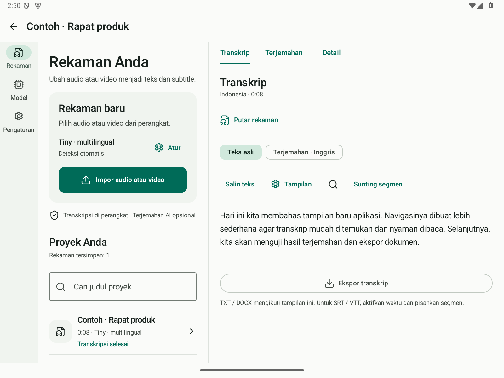

# Transcriptor

A small Android experiment for transcribing local audio and video, editing the text, and exporting captions. I started it while trying to get lyrics or captions for video editing without uploading my recordings to an online service.

This is a personal project built for fun. Local models give me more control over where processing happens, with compromises in speed, memory use and recognition quality on a phone. Treat the output as a draft and review it.

## Download v1.0

- [Release APK](https://github.com/tomzsh/Transcriptor/releases/download/v1.0/Transcriptor-v1.0-release.apk): everyday use, signed and non-debuggable.
- [Debug APK](https://github.com/tomzsh/Transcriptor/releases/download/v1.0/Transcriptor-v1.0-debug.apk): testing and diagnostics.
- [Release notes and checksums](https://github.com/tomzsh/Transcriptor/releases/tag/v1.0).

Android 8.0 (API 26) or newer, ARM64. Model weights download separately inside the app. Continue using the same APK variant when updating: debug and release have different signing certificates. Uninstalling removes private projects and downloaded models.

## What it does

- Transcribes imported audio/video on the device through whisper.cpp.
- Provides downloadable Whisper models, including an optional Cahya Indonesian fine-tune, with size/SHA-256 verification.
- Keeps editable source segments, timings and speakers beneath a clean paragraph reader.
- Translates the existing text with local AI models or an explicitly selected online provider using your own API key.
- Copies text and exports TXT, DOCX, SRT and VTT.
- Supports English/Indonesian UI, system/light/dark appearance, tablet layouts, progress, cancellation and local diagnostics.

*The screenshot uses synthetic example text.*

## Try it

1. Open **Models**, download a speech model, then return to **Recordings**.
2. Open **Configure** to choose the model, spoken language and optional speaker grouping. Import an audio or video file.
3. Open the recording and start transcription. Read, search or edit the result.
4. Use **Display** to reveal timestamps/speakers or separate segments. TXT/DOCX follow these preferences. SRT/VTT require timed, separate cues.
5. Optionally download an AI translator under **Models**, then translate the transcript from its **Translation** tab.

Transcription stays on the device. Choosing online translation sends transcript text and context to your selected provider. Local processing never silently switches to the cloud. See [privacy and diagnostics](docs/PRIVACY.md).

## Practical limits

A smaller model is often a more practical starting point on a phone. Larger models need more RAM and storage, can run more slowly, and may increase heat or battery use. Noise, accents, music, overlapping voices and mixed-language speech can reduce accuracy. Lyrics were a motivation, not a guarantee of accurate sung-lyric recognition.

Available Vulkan GPUs can accelerate the native engines, with CPU fallback. NPU/APU detection is informational; current GGML/GGUF inference does not use those processors. Device support does not promise equal speed on every chipset. See [models and hardware](docs/MODELS.md).

## Development

Kotlin, Jetpack Compose, Room, whisper.cpp and llama.cpp. See [building and testing](docs/BUILDING.md), [signing](SIGNING.md), [verification](docs/VERIFICATION.md) and [UI design](DESIGN.md).

Every update produces both debug and release. Local distributables go in ignored `artifacts/v<version>/`; GitHub Release assets distribute them. APKs, model weights, private keys and build caches stay out of source history.

## Creator and credits

Created by **tomz** ([GitHub](https://github.com/tomzsh)) from [qodequ.com](https://qodequ.com).

- [whisper.cpp](https://github.com/ggml-org/whisper.cpp): local speech recognition.
- [llama.cpp](https://github.com/ggml-org/llama.cpp): local GGUF AI inference; pinned upstream MIT license in `app/src/main/assets/licenses/llama.cpp.txt`.
- [Concat](https://github.com/jub0t/Concat): reference for the verified Whisper model catalog.
- [Lucide](https://lucide.dev): icons; ISC/MIT notices in `app/src/main/assets/licenses/lucide.txt`.
- [Impeccable](https://github.com/pbakaus/impeccable): native UI/UX guidance. [Material segmented buttons](https://developer.android.com/develop/ui/compose/components/segmented-button) and [Otter export options](https://help.otter.ai/hc/en-us/articles/360047733634-Export-conversations) informed the reader and output controls.
